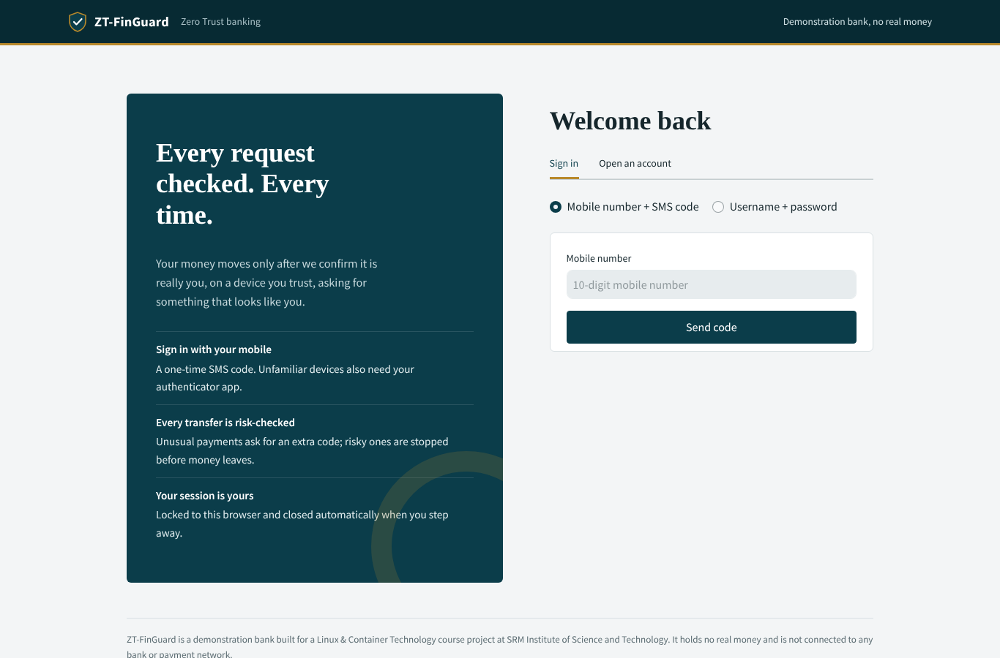
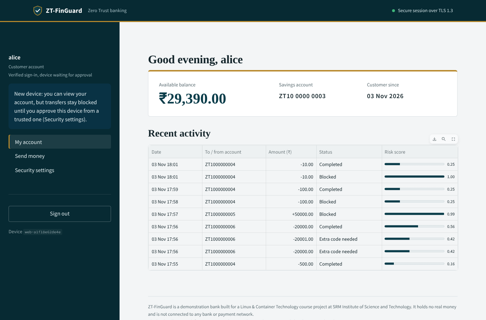

# ZT-FinGuard — Zero Trust Management for FinTech

Containerised banking microservices on Linux, secured with Zero Trust:
**never trust, always verify every request** (NIST SP 800-207).
Runs unchanged on **Docker** or **rootless Podman**.

> Course project · Linux & Container Technology · SRM IST, Dept. of Computing Technologies

## What it does

| Zero Trust control | How it is implemented |
|---|---|
| Verify every user | Password (scrypt) **+ TOTP MFA**, 15-min RS256 JWT, lockout after 5 failures, TOTP replay protection |
| Tokens can't be stolen and reused | Access token **bound to the device**; rotating refresh tokens with **reuse detection** (replay ⇒ all sessions killed) |
| Verify every service | **mTLS (TLS 1.3)** on every hop with a private CA; each endpoint has an allow-list of workload identities (cert CN) |
| Least privilege, per request | **OPA / Rego** policy evaluated on every action; separation of duties (admins can't move money) |
| Real-time risk | Fraud model trained on **PaySim** (leak-free features) + context rules; **explainable** reasons on every score |
| Adaptive access | Medium risk ⇒ **step-up MFA** bound to that exact transfer; high risk ⇒ deny **and revoke every session** (continuous evaluation) |
| Microsegmentation | 4 container networks (`edge`, `app`, `auth`, `db`); only the edge is reachable from the host |
| No shared DB account, no DB passwords | One Postgres role per service, **certificate login** (`pg_hba` `cert`), column-level grants |
| Tamper-evident audit | Every decision in a **SHA-256 hash-chained**, append-only log; one-click chain verification |
| Hardened containers | Non-root uid 10001, read-only rootfs, `cap_drop: ALL`, no-new-privileges, seccomp, cgroup limits, **no shell in images** |
| Supply chain + runtime | **Trivy** image/secret scan (CI gate), **Falco** eBPF rules streaming alerts to the audit log |
| Visibility | **Streamlit** security dashboard: decisions, denial reasons, risk mix, ZT overhead vs 100 ms budget, health, model card |
| **Customer-controlled session timeout** | customer picks the inactivity timeout, admin sets the maximum, gateway expires idle sessions; re-sign-in required (auto-refresh never counts as activity) |
| **Automatic container quarantine** | Falco alert ≥ Critical → `responder` disconnects the container from every network, alerts the admin; one-click release |
| **Device trust verification** | first device trusted; new devices are *pending* (view only, no transfers) until approved from a trusted device + TOTP; revoke ends sessions |
| **Teller portal** | 12 pages: counter deposits / withdrawals / transfers only after the customer proves identity (SMS code + authenticator), dual-control approvals (maker-checker, 2 approvers from ₹1 lakh), customer 360 with masked data, AI risk view, branch reports ([docs/teller-portal.md](docs/teller-portal.md)) |
| **Customer portal** | 11 pages: dashboard, accounts and statements, transfers with Indian payment methods and charges, history, devices, security center, fraud alerts with reasons, notifications, self-protection (freeze / lockdown / three-factor recovery), profile, support tickets ([docs/customer-portal.md](docs/customer-portal.md)) |
| **Admin security dashboard** | 11 modules: overview, identity & devices, banking operations (maker-checker), AI fraud intelligence, container security, threat center, incident response, network map, restrict-only policy editor, audit & compliance, security settings ([docs/admin-dashboard.md](docs/admin-dashboard.md)) |
| **Mobile + SMS OTP sign-in** | mobile number at sign-up; sign in with a one-time SMS code (5 min, single use, 3 tries); new device / unusual sign-in also needs the authenticator code. Simulated SMS inbox for the demo ([docs/mobile-otp.md](docs/mobile-otp.md)) |

## Architecture

```
            Browser
               │ HTTPS (TLS 1.3)
   ┌───────────▼────────────┐   edge-net (only zone published to host)
   │ dashboard (Streamlit)  │──HTTPS──▶ gateway ◀── API clients
   └────────────────────────┘             │ rate limit · JWT · device binding · revocation
                                          │ mTLS
           ┌──────────────────────────────┼─────────────────────────┐  app-net / auth-net
           ▼                              ▼                         ▼
        account ──mTLS──▶ OPA ◀──mTLS── transaction ──mTLS──▶ risk (PaySim model)
           │                               │   └──mTLS──▶ auth (MFA, tokens, revocation) ── redis (mTLS)
           │          every decision ──mTLS──▶ audit (hash chain)  ◀── Falco alerts (mTLS)
           ▼                               ▼                        ▼
   ┌────────────────────────── PostgreSQL (db-net, cert login) ────────────────────┐
```

Request flow for a transfer: **login + MFA → device-bound JWT → gateway checks → transaction service
re-verifies JWT → risk score → OPA decision → (step-up | deny + revoke | commit) → audit chain**.

## Quick start

Requirements: Linux, Docker 24+ with Compose v2 **or** Podman 4.4+ with `podman compose`, Python 3, OpenSSL.

```bash
./deploy.sh                # checks prerequisites, certs, build, waits until healthy
                           # (or step by step: make setup && make up; Podman: ./deploy.sh --podman)
make users                 # demo usernames, passwords and current authenticator codes
```

Open **https://localhost:8501** (import `certs/ca.crt` into your browser to remove the warning).

| User | Role | Try |
|---|---|---|
| `alice` (mobile 9876500001) | customer | sign in with mobile + SMS code; send ₹750 to `ZT1000000004` → allowed (low risk) |
| `alice` | customer | send ₹20,000 to a new payee → **step-up** code required |
| `bob` | customer | send his whole balance → **blocked + all sessions ended** |
| `teller` | teller | verify a customer at the counter (SMS + authenticator), cash deposit / withdrawal, approve others' held transactions (never its own) |
| `ops` | operations | banking desk: approve high-value transfers, freeze accounts, set daily limits, receipts |
| `meera` | customer | business account (₹5,00,000): send ₹55,000 → waits for operations approval |
| `admin` | admin | security dashboard, decisions, model card, audit-chain verification |

Each code works once. Add the TOTP secret from `make users` to Google Authenticator to sign in from your phone.

## Live 24/7 on Oracle Cloud Always Free (one command, free forever)

In the Oracle console's Cloud Shell (`>_`):

```bash
curl -fsSL https://raw.githubusercontent.com/BALASUDHAN1807/zt-finguard/main/deploy/oracle-cloudshell.sh | bash
```

It creates the network and a free ARM VM (4 CPU / 24 GB), deploys everything and prints the
public `https://<ip>.sslip.io` address. Guide: **[docs/deploy-oracle.md](docs/deploy-oracle.md)**.
Using Azure for Students instead: the same works in Azure Cloud Shell with `deploy/azure-cloudshell.sh`.

## Deploy to the cloud (Docker)

On any Ubuntu 22.04/24.04 VM with 4 GB+ RAM (Azure for Students, Oracle Always Free, AWS t3.medium...):

```bash
unzip zt-finguard.zip && cd zt-finguard
./deploy/cloud-setup.sh      # installs Docker, firewall, HTTPS (Let's Encrypt), builds and starts everything
```

Pre-built images on Docker Hub (`make push IMAGE_PREFIX=bala1807/zt-finguard-`, see
[docs/docker-hub.md](docs/docker-hub.md)) let the VM pull instead of build:
`IMAGE_PREFIX=bala1807/zt-finguard- ./deploy/cloud-setup.sh`.

You get a public `https://<ip>.sslip.io` address with a trusted certificate. Only Caddy (80/443)
is reachable from the internet. Step-by-step guide: **[docs/deploy-cloud.md](docs/deploy-cloud.md)**.

## Dashboard (Streamlit)

The dashboard is an ordinary client of the gateway. It has no certificates for the internal
network, no database access and no secrets. Users sign in with password + TOTP and every page goes
through the same checks as any API call.

| Role | Pages |
|---|---|
| customer | **Dashboard** · **My accounts** (details, balance, statements) · **Money transfer** (IMPS / NEFT / RTGS / internal, charges, review, step-up MFA) · **Transaction history** (search, filters, export, report) · **My devices** · **Security center** · **AI fraud protection** · **Notifications** (in-app + simulated SMS / e-mail) · **Account protection** (freeze, transfer switch, lockdown, recovery) · **My profile** · **Customer support** - see [docs/customer-portal.md](docs/customer-portal.md) |
| teller | **Teller dashboard** · **Customer lookup** · **Identity verification** (SMS + authenticator at the counter) · **Transaction management** (deposit / withdrawal / transfer) · **Transaction approvals** (maker-checker, dual control) · **AI risk assessment** · **Transaction history** · **Branch operations** · **Teller security center** · **Customer support** · **Reports & audit history** · **Teller profile & settings** - see [docs/teller-portal.md](docs/teller-portal.md) |
| operations | **Banking & transactions** (accounts, pending approvals, freeze, daily limits, receipts, support tickets) · **Transaction approvals** |
| every role | **Security settings** (inactivity timeout, my devices: approve / revoke) |
| admin | **Security overview** · **Identity & devices** · **AI fraud intelligence** · **Container security** · **Threat center** · **Incident response** · **Network visualization** · **Policy management** (restrict-only editor, simulation, versions, rollback) · **Audit & compliance** (explorer, export, compliance report) · **Access decisions** · **Session & device policy** · **Security settings** (platform settings, keys & certificates) - see [docs/admin-dashboard.md](docs/admin-dashboard.md) |

| | |
|---|---|
|  |  |
|  |  |
|  |  |

## Tests

```bash
make opa-test     # 40 policy unit tests
make test         # 68 end-to-end tests (49 core + 7 customer + 5 teller portal + 7 container tests; stack must be running)
make scan         # Trivy; fails on CRITICAL vulnerabilities or leaked secrets
```

The end-to-end suite checks, against the live system: TLS 1.3 only, MFA, TOTP replay, no user
enumeration, device binding, logout revocation, `alg:none` forgery, refresh-token reuse detection,
broken object-level authorisation, teller/admin separation of duties, low/medium/high-risk transfer
paths, step-up token binding, session revocation after a high-risk transfer, audit chain integrity
account lockout, SMS OTP sign-in (single use, 3 tries, step-up on new devices, no enumeration), and every admin dashboard module (policy editor restrict-only, compliance evidence, incident playbooks, settings).

## Linux & container features used

* **User namespaces** – rootless Podman maps container uid 10001 to an unprivileged subuid on the host (`podman unshare cat /proc/self/uid_map`).
* **Capabilities** – `cap_drop: [ALL]`; Postgres gets back only `CHOWN, DAC_OVERRIDE, FOWNER, SETGID, SETUID`.
* **seccomp + no-new-privileges** – engine default seccomp profile; setuid binaries cannot raise privileges.
* **cgroups v2** – `mem_limit`, `cpus`, `pids_limit` per container (fork-bomb and DoS containment).
* **Read-only root filesystem** – writable `tmpfs` only for `/tmp`; keys copied there with mode 0600.
* **Network namespaces** – four bridge networks, three marked `internal` (no route out).
* **Secrets** – files mounted at `/run/secrets/`, never in env vars or images.
* **eBPF** – Falco `modern_ebpf` probe watches syscalls of every container.

## Risk model

```bash
make train                                   # synthetic PaySim-shaped sample (bundled, for demos)
make train DATA=/path/PS_20174392719_1491204439457_log.csv   # real PaySim from Kaggle
```

Only features known **before** money moves are used (`type`, `amount`, `amount / sender balance`,
empty sender/receiver balance, hour). `train.py` also trains a *leaky* baseline with the
post-transaction balances to show why those columns must be excluded. Metrics are written to
`services/risk/model/metrics.json` and shown on the dashboard. **Report numbers only from the real
PaySim run** — the bundled model is trained on synthetic data.

## Layout

```
compose.yaml            11 services, 4 networks, secrets, hardening
services/Containerfile  one hardened multi-stage image recipe
services/common/        ztcommon: mTLS server/client, JWT, OPA/audit/Redis clients
services/{gateway,auth,account,transaction,risk,audit,responder,dashboard}/
policies/               Rego policy + tests + OPA API authorization
db/                     schema, per-service roles, pg_hba (cert auth), TLS start-up
falco/zt_rules.yaml     runtime detection rules
scripts/                PKI, secrets, Trivy scan, demo users
tests/test_e2e.py       end-to-end Zero Trust tests
docs/                   evaluation, cloud deployment, features 19-21 (session-device-quarantine.md)
```

## References

NIST SP 800-207 (Zero Trust Architecture) · NIST SP 800-190 (Container Security) ·
NIST SP 800-204A (Service-mesh microservices) · CISA Zero Trust Maturity Model v2.0 ·
Lopez-Rojas et al., *PaySim*, EMSS 2016.
