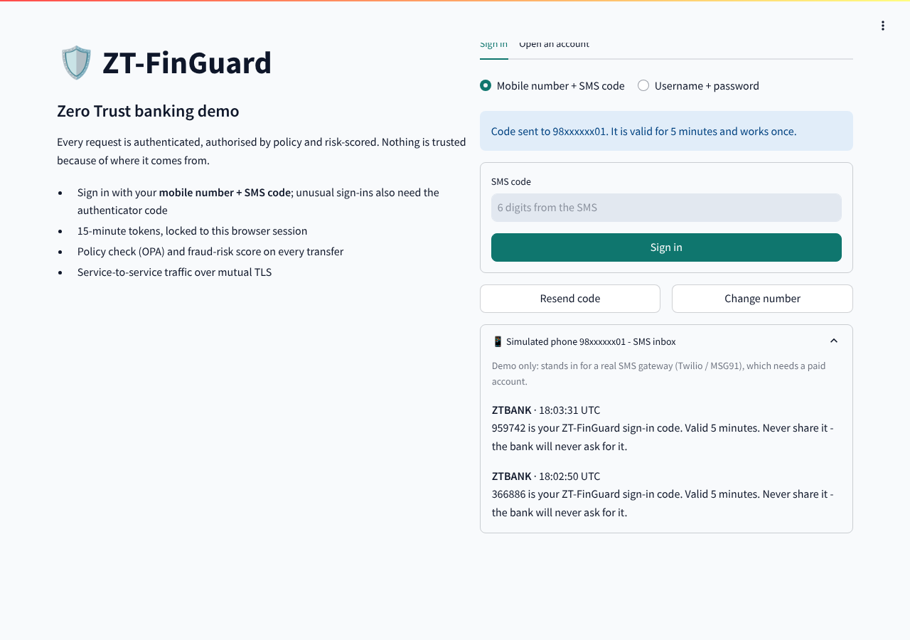
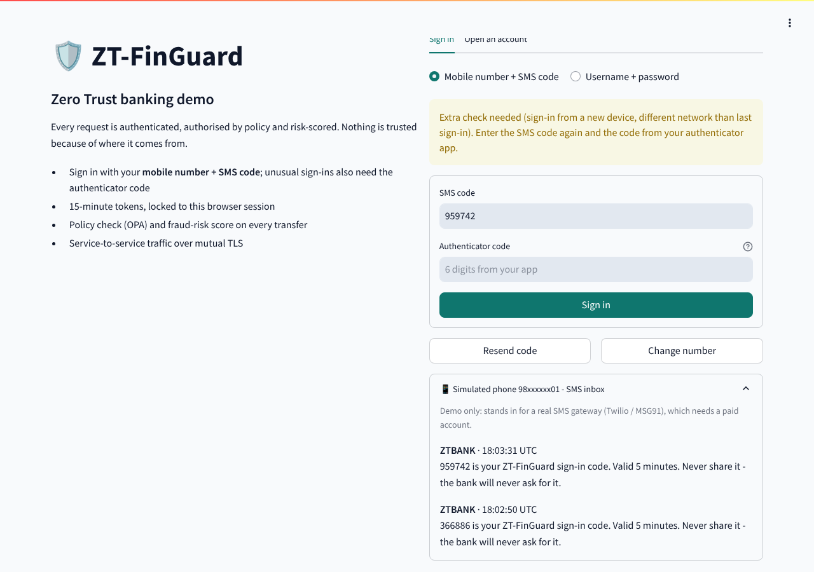
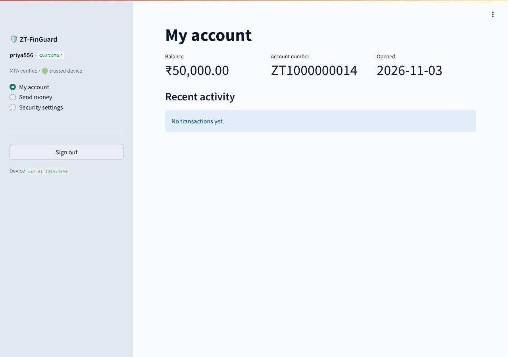

# Feature 22 - Mobile number + SMS OTP sign-in

Customers register a mobile number and sign in with a one-time code sent by SMS.
Zero Trust still decides how much proof is needed for **each** sign-in:

| Situation | What the customer enters | Token `amr` |
|---|---|---|
| Trusted device, no risk signals | mobile → **SMS code** | `["sms","dev"]` (code + bound trusted device) |
| New or pending device, new network, recent failures or 00:00-06:00 | SMS code **+ authenticator code** (step-up) | `["sms","otp"]` |
| Login risk high | blocked | - |
| Staff / fallback | username + password + authenticator code | `["pwd","otp"]` |

## Controls

* 6-digit code from `secrets.randbelow`, stored only as a salted SHA-256 hash in Redis
  (mTLS), valid **5 minutes**, works **once**, destroyed after **3** wrong guesses.
* At most **3 SMS per number per 10 minutes**, **30 s** between two codes, plus the gateway's
  sign-in rate limit per IP.
* `/otp/request` answers the same for registered and unknown numbers (no user enumeration).
* Every wrong code counts towards the 5-failure account lockout.
* Mobile numbers: 10-digit Indian format (`+91`/`0` prefixes accepted), unique,
  enforced by a database CHECK constraint. Shown masked (`98xxxxxx01`).
* Every request, step-up, failure and success is written to the hash-chained audit log.

## SMS delivery

`SMS_PROVIDER=simulated` (default) puts the message in a per-number inbox in Redis; the
sign-in page shows it as a "simulated phone", so the demo needs no paid SMS account.
The auth container has **no internet route** (auth-net is internal), so a real gateway
(Twilio, MSG91 with Indian DLT registration) belongs in a separate notifier container on an
egress-only network. Any other provider value fails closed (sign-in refused), and the demo
inbox endpoint returns 404.

## Demo numbers

| user | mobile |
|---|---|
| admin | 9000000001 |
| teller | 9000000002 |
| alice | 9876500001 |
| bob | 9876500002 |
| victim_demo | 9876500003 |

`make users` prints them. Existing databases get the column from `db/migrations/002-mobile-otp.sql`,
which `./deploy.sh` applies automatically.

