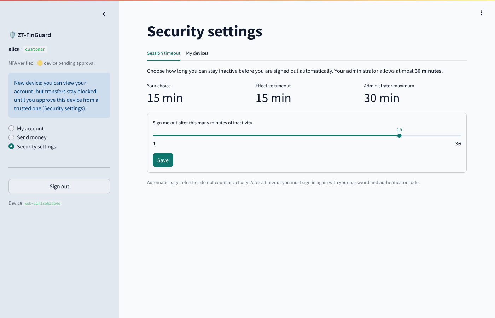
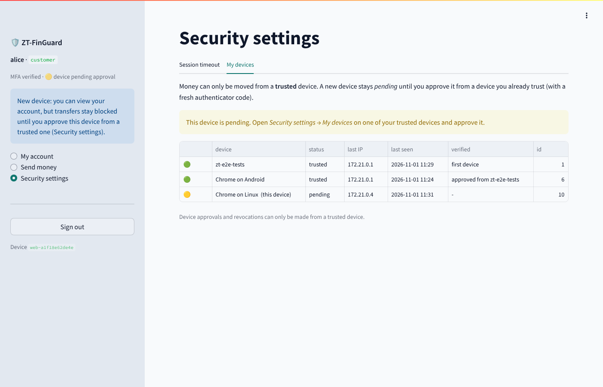
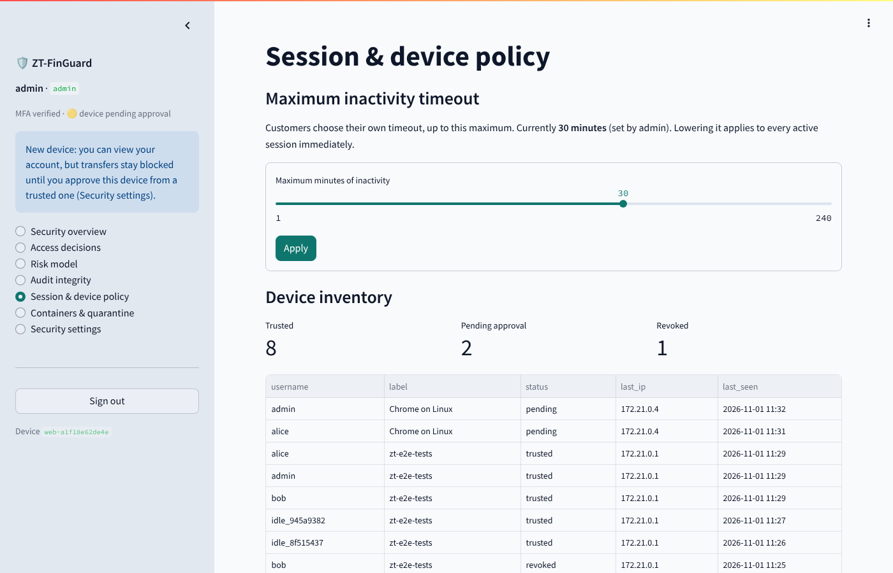
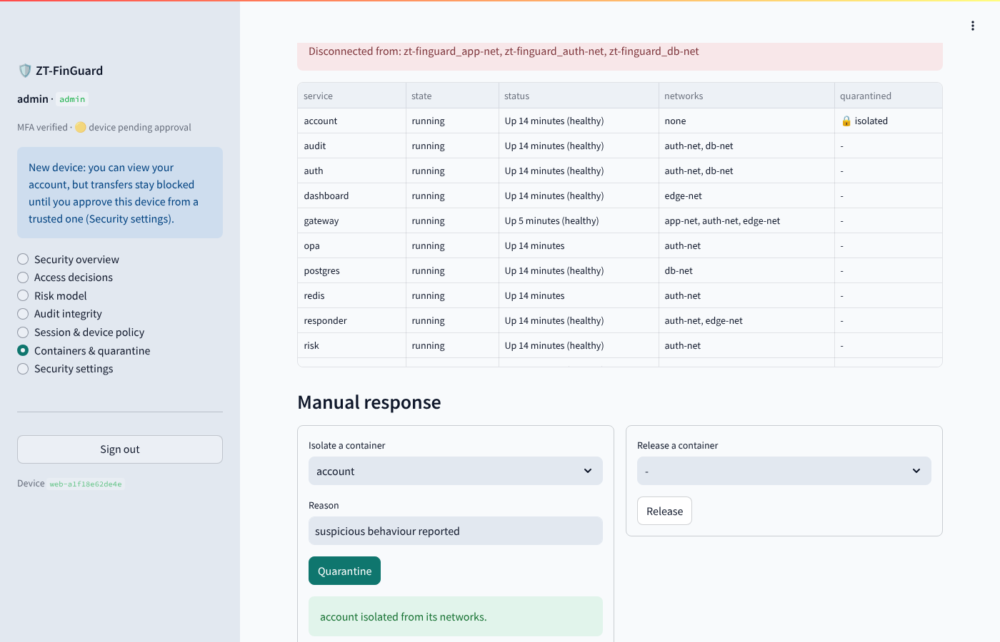

# Features 19-21: session timeout, container quarantine, device trust

## 19. Customer-controlled session timeout

| | |
|---|---|
| Customer | *Security settings → Session timeout*: picks 1-240 minutes of allowed inactivity |
| Administrator | *Session & device policy*: sets the **maximum** any customer may choose (default 30 min) |
| Enforcement | gateway, on every request: `effective = min(customer choice, admin maximum)` |
| After expiry | session key deleted, refresh token family revoked → **password + TOTP sign-in required** |
| Technology | JWT (`sid` claim = session id), Redis (last-activity timestamp), PostgreSQL (settings), FastAPI gateway |

How it works

1. At sign-in the auth service creates a session id (`sid`), stores `sess:<sid> = now` in Redis and
   puts `sid` in the RS256 access token. Refreshed tokens keep the same `sid`.
2. On every API call the gateway compares `now - last_activity` with the effective timeout. If it is
   exceeded the request is rejected with `session_idle_timeout_<n>m`, the session key is deleted and
   the refresh-token family is revoked; otherwise the activity time is updated.
3. Requests marked `X-ZT-Background: 1` (dashboard auto-refresh) and token refreshes are checked but
   **never count as activity**, so an unattended screen cannot keep a session alive.
4. Lowering the administrator maximum applies immediately to every active session.

Evidence: `test_admin_maximum_caps_customer_choice`,
`test_inactive_session_expires_and_background_polling_does_not_keep_it_alive`.

## 20. Automatic container quarantine

| | |
|---|---|
| Detection | Falco (eBPF) rules in `falco/zt_rules.yaml` |
| Response | `responder` service receives Falco's alerts over mTLS (`http_output`) |
| Action | priority ≥ `QUARANTINE_MIN_PRIORITY` (default **Critical**) → container **disconnected from every network** (app, auth, db, edge); optionally paused (`QUARANTINE_PAUSE=1`) |
| Alert | `container.quarantine` alert in the audit log (dashboard), optional webhook `ALERT_WEBHOOK_URL` (Slack/Discord/Telegram-bridge compatible JSON) |
| Recovery | administrator → *Containers & quarantine → Release*: original networks and DNS aliases restored |
| Technology | Falco, Docker Engine API / Podman Docker-compatible API, FastAPI responder |

Why isolate instead of kill? The attacker loses every route to the database, Redis and other
services at once, while the process tree, memory and files stay available for investigation
(`docker exec`, `docker diff`, `docker export`). Killing would destroy that evidence.

Least privilege for the responder: it is the only workload with the container-engine socket, gets
access through the socket's *group* (still uid 10001, read-only rootfs, no capabilities), accepts calls
only from the `falco` and `gateway` certificates, only touches containers labelled
`com.docker.compose.project=zt-finguard`, never itself or Falco, and only calls network
disconnect/connect and pause/unpause. For stricter setups put a socket proxy in front of it that
allows only those endpoints.

```bash
make falco                          # start Falco (rootful Docker only)
docker compose logs -f responder    # watch automatic responses
```

Evidence (Docker deployment, `make test`): `test_manual_quarantine_isolates_container_and_release_restores_it`,
`test_falco_alert_triggers_automatic_quarantine`, `test_responder_refuses_non_falco_callers_and_low_severity`.

## 21. Device trust verification

| | |
|---|---|
| Registration | every sign-in records the device (browser fingerprint: user agent, language, platform) |
| First device | trusted automatically (bootstrap) |
| New device | **pending**: can sign in and view the account, **cannot move money** (OPA: `device_not_trusted`) |
| Verification | approved from an already-trusted device **plus a fresh authenticator code**; a pending device can never approve itself |
| Recovery | if no trusted device is left, the current device can be verified with a fresh TOTP code |
| Revocation | revoking a device ends its sessions immediately (gateway) and blocks it from signing in again |
| Visibility | customers: *Security settings → My devices*; admins: device inventory; alert on every new pending device |

Enforcement points

* auth: registers devices, decides trusted/pending, blocks sign-in from revoked devices
* gateway: reads the live device status from Redis on every request and rejects revoked devices
* transaction: passes `device_trust` to OPA; the policy denies transfers unless it is exactly
  `"trusted"`, so a missing value fails closed (covered by a policy unit test)

Limits (state them in the viva): the browser fingerprint identifies a browser, not hardware. A real
deployment would add a per-device key (WebAuthn / passkey or a mobile-app keypair) so the device
proves possession cryptographically.

Evidence: `test_new_device_is_pending_and_cannot_move_money_until_approved`,
`test_revoking_a_device_ends_its_session_and_blocks_sign_in`, OPA tests
`test_transfer_from_pending_device_denied`, `test_transfer_without_device_info_fails_closed`,
`test_step_up_cannot_bypass_untrusted_device`.

## Screenshots

| | |
|---|---|
|  |  |
|  |  |
